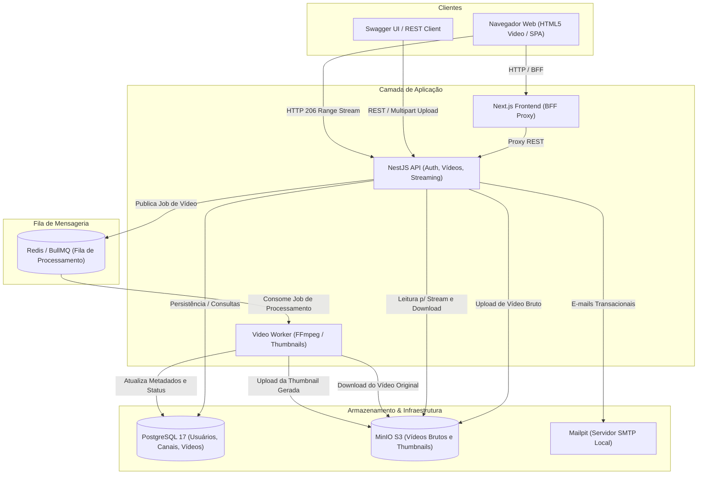
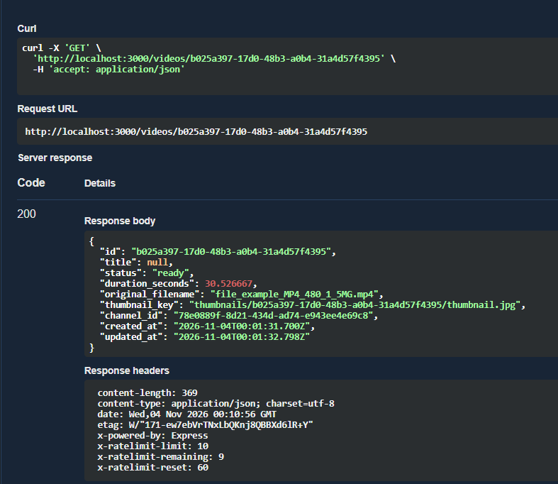
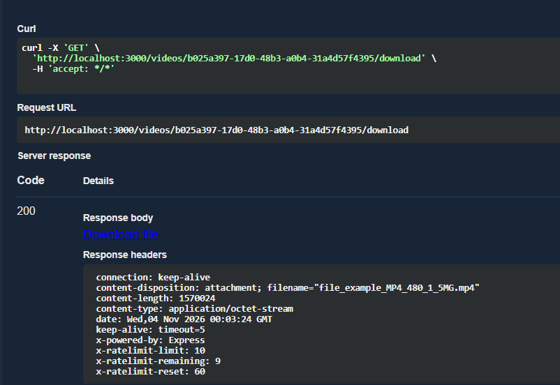
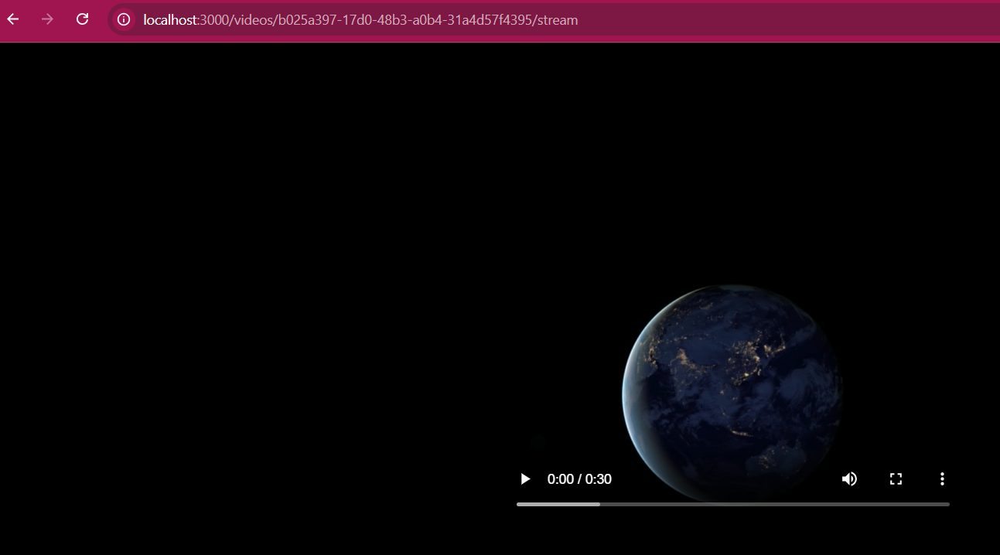

# StreamTube — Plataforma de Compartilhamento de Vídeos

O **StreamTube** é uma plataforma de compartilhamento e streaming de vídeos no estilo YouTube, desenvolvida como projeto de referência do módulo de **Desenvolvimento de Software e Aplicações com IA** do MBA de Engenharia de Software com IA da [Full Cycle](https://fullcycle.com.br).

O projeto é construído em modelo *greenfield* orientado por agentes de IA, aplicando as melhores práticas de engenharia de software: arquitetura limpa, responsabilidade única, tipagem estrita com TypeScript, cobertura piramidal de testes (unitários, integração e ponta a ponta), filas assíncronas para processamento pesado e infraestrutura conteinerizada com Docker.

---

## ⚙️ Como o Projeto Funciona

O StreamTube opera como uma arquitetura distribuída e conteinerizada, projetada para desacoplar tarefas síncronas de alta concorrência das tarefas pesadas de processamento multimídia.

### 🏛️ Arquitetura dos Serviços



1. **API NestJS (11.x)**: Núcleo das regras de negócio, autenticação (JWT com rotação de refresh tokens), gerenciamento de usuários, canais, upload via streaming e entrega de mídia.
2. **PostgreSQL 17**: Banco de dados relacional com TypeORM para persistência de entidades, migrações versionadas e integridade referencial.
3. **MinIO (S3-Compatible Object Storage)**: Armazenamento distribuído para arquivos grandes, separando vídeos originais (`streamtube-videos`) e imagens de miniatura (`streamtube-thumbnails`).
4. **Redis + BullMQ**: Fila de mensagens em memória para gerenciamento e despacho de jobs assíncronos de vídeo.
5. **Video Worker (FFmpeg)**: Consumidor de jobs em segundo plano responsável pela extração de metadados técnicos (duração, dimensões, codecs) e geração automatizada de thumbnails.
6. **Mailpit**: Servidor SMTP local para captura de e-mails transacionais (confirmação de conta e recuperação de senhas).
7. **Next.js Frontend (16.x)**: Aplicação web em React 19 utilizando o padrão BFF (Backend For Frontend).

---

### 🎬 Fluxo de Upload, Processamento e Streaming (Fase 03)

O ciclo de vida de um vídeo no StreamTube segue as etapas abaixo:

1. **Upload via Streaming**:
   - O cliente autenticado envia o arquivo via `POST /videos/upload` (multipart/form-data).
   - O payload de bytes é transmitido por streaming diretamente para o MinIO, sem carregar o vídeo inteiro na memória RAM da API.
   - O registro é inserido no banco de dados com status `pending_upload` e um job de processamento é disparado na fila BullMQ.

2. **Processamento Assíncrono**:
   - O processador consome o job da fila e atualiza o status do vídeo para `processing`.
   - O FFmpeg analisa os metadados do arquivo (tempo de duração exato, resolução e formato) e gera uma imagem de thumbnail no frame de 1 segundo.
   - A thumbnail gerada é enviada para o bucket do MinIO.
   - Ao concluir com sucesso, o registro no banco tem seus metadados persistidos e o status é alterado para `ready`. Em caso de falha, o status vai para `error` com a mensagem diagnóstica.

3. **Streaming com HTTP Range (206 Partial Content)**:
   - A rota pública `GET /videos/:id/stream` atende requisições de players HTML5.
   - A API suporta o cabeçalho `Range: bytes=inicio-fim`, permitindo ao reprodutor buscar pedaços específicos (seek) instantaneamente sem precisar baixar o arquivo inteiro.

4. **Download**:
   - A rota `GET /videos/:id/download` permite baixar o arquivo original com o cabeçalho `Content-Disposition: attachment`.

---

## 📸 Demonstração de Funcionamento (Swagger & Streaming)

Os prints abaixo comprovam o funcionamento real dos endpoints integrados da API e do streaming de vídeo:

### 1. Consulta de Metadados do Vídeo Processado (`GET /videos/{id}`)
O vídeo é consultado via Swagger UI após o processamento assíncrono. Retorna status `ready`, duração calculada via FFmpeg (~30.5 segundos) e a chave da thumbnail gerada no MinIO:



---

### 2. Download do Vídeo Original (`GET /videos/{id}/download`)
Requisição de download através do Swagger UI, retornando status `200 OK`, `content-type: application/octet-stream` e cabeçalho `content-disposition` com o nome do arquivo original anexado:



---

### 3. Streaming do Vídeo em Tempo Real (`GET /videos/{id}/stream`)
O endpoint de stream acessado diretamente no navegador web. O player HTML5 nativo consome o vídeo através de requisições parciais (`206 Partial Content`), permitindo reprodução com barra de progresso, áudio e controles de reprodução:



---

## 🧠 Desenvolvimento Orientado por IA (Workflow & Skills)

O StreamTube adota uma abordagem pioneira de **Engenharia de Software Orientada por IA**. A inteligência artificial não atua apenas como autocompletar de código, mas como co-autora e ferramenta de produção guiada pelo desenvolvedor, que atua como **maestro do processo**: conduzindo o fluxo, refinando decisões, consultando documentação oficial de bibliotecas e garantindo a coerência dos artefatos.

### 🔄 Pipeline do Workflow de Engenharia

O ciclo de entrega de cada fase do projeto segue um pipeline estrito e iterativo:

```
┌───────────┐      ┌────────────┐      ┌──────────────┐      ┌─────────────────┐      ┌────────────────────┐
│  Research │ ───> │   Decide   │ ───> │  Plan-Phase  │ ───> │ Implement-Phase │ ───> │ Definition of Done │
│ (Pesquisa)│      │ (Decisões) │      │ (Plano e SIs)│      │  (Execução SI)  │      │  (Testes/Lint/TS)  │
└───────────┘      └────────────┘      └──────────────┘      └─────────────────┘      └────────────────────┘
```

1. **`research` (Pesquisa Técnica):** Levantamento das capacidades e versões das bibliotecas no manifesto (`package.json`), investigando documentações oficiais (ex: MinIO S3 Client, BullMQ, Fluent-FFmpeg) antes de qualquer implementação.
2. **`decide` (Decisões Técnicas Formais):** Análise crítica de alternativas de arquitetura, registrando prós, contras e motivações em documentos versionados (ex: `docs/decisions/technical-decisions-upload-processing.md`).
3. **`plan-phase` (Planejamento da Fase):** Decomposição da fase em **Step Implementations (SIs)** atômicos e incrementais, especificando arquivos afetados, testes exigidos e critérios de conclusão (ex: `docs/phases/phase-03-upload/phase-03-upload.md`).
4. **`implement-phase` (Implementação Iterativa):** Execução metódica SI por SI, aplicando testes contínuos e registrando o progresso em tempo real (`.progress.md`).
5. **`Definition of Done`:** Nenhuma entrega é finalizada sem validação quádrupla: suíte completa de testes (unitários, integração e E2E), tipagem TypeScript estrita sem erros (`tsc --noEmit`), aprovação no linter (`eslint`) e build de produção.

### 🧰 Catálogo de Skills e Sub-Agents

A governança do projeto é suportada por um conjunto de **skills modulares** localizadas em `.claude/skills/` (com diretrizes adaptadas para Antigravity/Gemini em `GEMINI.md`):

| Categoria | Skill | Finalidade |
|-----------|-------|------------|
| **Processo** | `research` | Conduz investigação técnica aprofundada de requisitos e bibliotecas de terceiros |
| **Processo** | `decide` | Estrutura triagens arquiteturais e gera Technical Decisions (TDs) |
| **Processo** | `plan-phase` | Gera planos de fase atômicos com especificação detalhada de cada Step Implementation |
| **Processo** | `implement-phase` | Guia a execução dos SIs mantendo testes e arquivos de progresso atualizados |
| **Domínio** | `nestjs-best-practices` | Garante padrões de injeção de dependência, módulos coesos e separação de responsabilidades |
| **Domínio** | `typeorm` | Padroniza entidades, relacionamentos, migrações seguras e queries performáticas |
| **Domínio** | `testing-guide-nestjs-project` | Governa a pirâmide de testes (Jest, mocks adequados, isolamento e E2E com Supertest) |

### 🧭 Guia Prático: Como Usar as Skills na Ordem Correta

O desenvolvedor sabe exatamente quando e como acionar cada skill seguindo a regra fundamental: **cada etapa consome os artefatos da etapa anterior e produz o artefato exigido pela próxima**. Nunca se implementa sem plano, e nunca se planeja sem decisões técnicas tomadas.

| Ordem | Etapa / Ação | Entrada | Como Acionar a IA | Artefato Gerado (Saída) |
|:-----:|--------------|---------|-------------------|--------------------------|
| **1º** | **Pesquisa Técnica** | `docs/project-plan.md` (requisitos da fase) | *"Leia `.claude/skills/research/SKILL.md` e faça o research da fase X..."* (ou `/research <fase>`) | `docs/phases/<fase>/research.md` com APIs investigadas e dependências |
| **2º** | **Tomada de Decisões** | Dúvidas arquiteturais levantadas no research | *"Leia `.claude/skills/decide/SKILL.md` e trie as decisões para os pontos X, Y e Z..."* (ou `/decide "..."`) | `docs/decisions/technical-decisions-<tema>.md` com todas as opções decididas |
| **3º** | **Planejamento da Fase** | Technical Decisions decididas + plano do projeto | *"Leia `.claude/skills/plan-phase/SKILL.md` e crie o plano de implementação da fase X..."* (ou `/plan-phase <fase>`) | `docs/phases/<fase>/<fase>.md` e `<fase>.progress.md` com os SIs decompostos |
| **4º** | **Implementação Iterativa** | Plano da fase com SIs atômicos | *"Leia `.claude/skills/implement-phase/SKILL.md` e execute o próximo SI pendente..."* (ou `/implement-phase`) | Código implementado, testes do SI passando e `.progress.md` atualizado |
| **5º** | **Skills de Domínio** *(sob demanda)* | Contexto específico de desenvolvimento | A IA carrega automaticamente ou sob instrução (`nestjs-best-practices`, `typeorm`, `testing-guide`) | Código aderente aos padrões de NestJS, TypeORM e pirâmide de testes |
| **6º** | **Validação Final (DoD)** | Todos os SIs marcados como concluídos | *"Execute a validação completa de testes, tsc, lint e build..."* | Suíte de testes 100% verde, `tsc` code 0, linter sem warnings |

> [!TIP]
> **Compatibilidade de Ferramentas de IA:** No **Claude Code**, as skills podem ser chamadas como slash commands nativos (`/research`, `/plan-phase`). Em outras ferramentas agênticas (como **Antigravity / Gemini CLI**), o fluxo é guiado pelo arquivo `GEMINI.md`, onde o desenvolvedor instrui a IA a ler o `SKILL.md` correspondente e executar seu protocolo.

### 📂 Rastreabilidade e Transparência

Toda a evolução do projeto e a atuação da IA permanecem auditáveis no repositório:
- `docs/decisions/` — Registro histórico das decisões de engenharia tomadas.
- `docs/phases/` — Planos de trabalho, requisitos e rastreamento de progresso de cada fase.
- `GEMINI.md` / `CLAUDE.md` — Instruções, regras de arquitetura e convenções fornecidas aos agentes de IA.

---

## 🤝 Como Contribuir

Contribuições são muito bem-vindas! Siga os passos abaixo para configurar o ambiente de desenvolvimento local, executar a suíte de testes e enviar alterações.

### 📋 Pré-requisitos

- [Docker](https://www.docker.com/) e Docker Compose instalados e em execução.
- [Node.js](https://nodejs.org/) versão 20+ ou 22+ (caso queira executar ferramentas no host).
- [Git](https://git-scm.com/).

---

### 🚀 Configurando o Ambiente Local

1. **Clonar o Repositório:**
   ```bash
   git clone <URL_DO_REPOSITORIO>
   cd mba-ia-greenfield-project
   ```

2. **Iniciar a Infraestrutura do Backend:**
   A infraestrutura completa roda isolada em containers Docker Compose (PostgreSQL, Redis, MinIO, Mailpit e NestJS API):
   ```bash
   cd nestjs-project
   docker compose up -d
   ```

3. **Instalar Dependências (dentro do container):**
   ```bash
   docker compose exec nestjs-api npm install
   ```

4. **Executar as Migrations do Banco de Dados:**
   ```bash
   docker compose exec nestjs-api npm run migration:run
   ```

5. **Iniciar o Servidor em Modo de Desenvolvimento (com Swagger):**
   ```bash
   docker compose exec -d -e SWAGGER_ENABLED=true nestjs-api npm run start:dev
   ```

Após a inicialização, os serviços estarão disponíveis nos seguintes endereços:
- **Swagger UI:** [http://localhost:3000/api/docs](http://localhost:3000/api/docs)
- **MinIO Console:** [http://localhost:9001](http://localhost:9001) *(login: `minioadmin` / `minioadmin`)*
- **Mailpit Web UI:** [http://localhost:8025](http://localhost:8025)
- **PostgreSQL:** `localhost:5432` *(db: `streamtube`, user: `streamtube`)*

---

### 🧪 Executando os Testes

O projeto adota a pirâmide de testes e exige que todas as suítes estejam passando antes de aceitar qualquer alteração:

```bash
# Testes Unitários e de Integração
docker compose exec nestjs-api npm test

# Testes de Integração específicos
docker compose exec nestjs-api npm run test:integration

# Testes Ponta a Ponta (E2E)
docker compose exec nestjs-api npm run test:e2e

# Cobertura de Testes
docker compose exec nestjs-api npm run test:cov
```

---

### 🛡️ Definition of Done (Critérios de Qualidade)

Antes de abrir qualquer Pull Request, certifique-se de que sua alteração atende integralmente aos 4 pilares da **Definition of Done**:

1. **Testes Verificados:** A suíte relevante e todos os testes da aplicação passam sem falhas:
   ```bash
   docker compose exec nestjs-api npm test
   docker compose exec nestjs-api npm run test:e2e
   ```
2. **Compilação TypeScript Limpa:** Zero erros de tipo:
   ```bash
   docker compose exec nestjs-api npx tsc --noEmit
   ```
3. **Linter e Formatação:** Código aprovado nas regras do ESLint:
   ```bash
   docker compose exec nestjs-api npm run lint
   ```
4. **Build de Produção:**
   ```bash
   docker compose exec nestjs-api npm run build
   ```

---

### 🌿 Fluxo Git & Convenções de Branches

- **Branch principal estável:** `main` (nunca commitar diretamente nela).
- **Branch de integração:** `dev` (todas as features e correções partem de `dev` e retornam para `dev`).
- **Padrão de nomenclatura de branches:**
  - `feature/<nome-da-funcionalidade>`
  - `bugfix/<descricao-do-ajuste>`
  - `hotfix/<correcao-critica>`
  - `docs/<atualizacao-de-documentacao>`
- **Commits:** Mensagens curtas, em modo imperativo, focadas no *porquê* da alteração (ex: `feat(videos): add http 206 range streaming support`).
