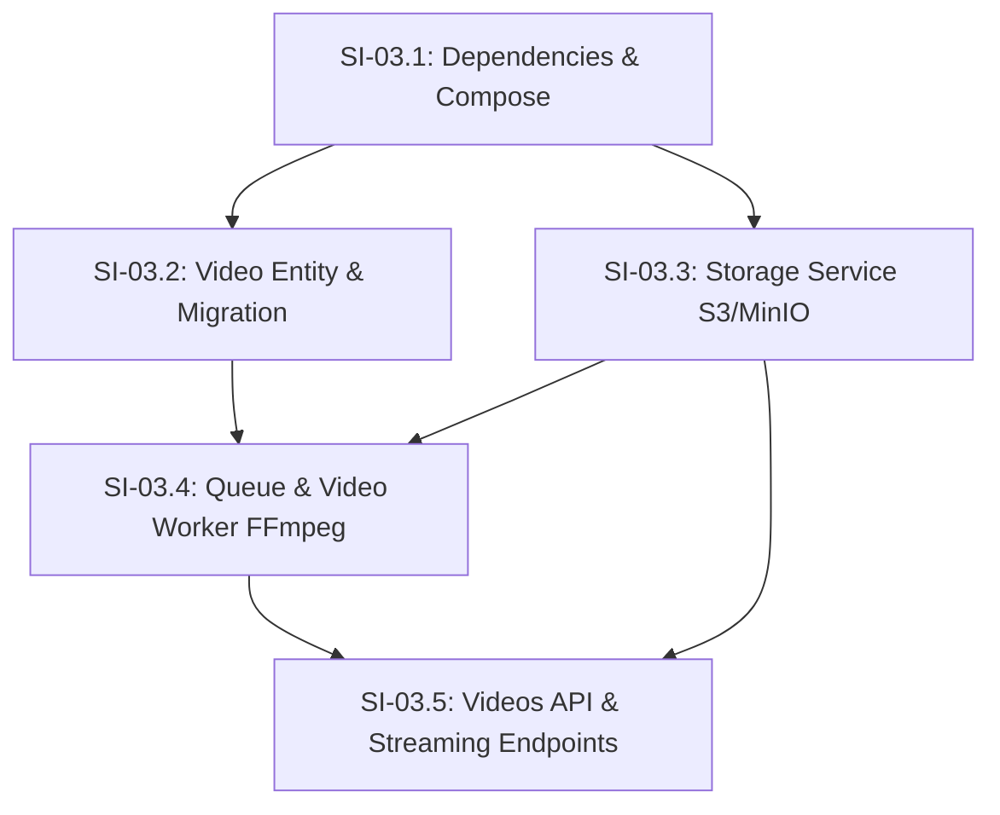

# Phase 03 — Upload e Processamento de Vídeos

## Objective

Deliver the complete video upload and background processing infrastructure — supporting large video files up to 10GB via non-blocking direct-to-storage presigned uploads, automatic draft pre-registration, an asynchronous BullMQ queue with a containerized FFmpeg video worker for metadata/duration extraction and thumbnail generation, clean 12-character unique URL codes, HTTP Range (206 Partial Content) streaming, and video binary download endpoints.

---

## Step Implementations

### SI-03.1 — Dependencies, Environment Configuration Namespaces, and Docker Compose Services

**Description:** Install all Phase 03 production dependencies (`@aws-sdk/client-s3`, `@aws-sdk/s3-request-presigner`, `@nestjs/bullmq`, `bullmq`, `ioredis`, `fluent-ffmpeg`, `@types/fluent-ffmpeg`, `nanoid`), create `storage` and `redis` config namespaces, extend the Joi environment validation schema, and add `storage` (MinIO), `redis`, and `video-worker` services to Docker Compose.

**Technical actions:**

- Install dependencies in `nestjs-project/package.json`: `@aws-sdk/client-s3@^3.738.0`, `@aws-sdk/s3-request-presigner@^3.738.0`, `@nestjs/bullmq@^11.0.2`, `bullmq@^5.41.0`, `ioredis@^5.5.0`, `fluent-ffmpeg@^2.1.3`, `@types/fluent-ffmpeg@^2.1.27`, `nanoid@^3.3.8`.
- Update `nestjs-project/Dockerfile.dev` to install `ffmpeg` and `ffprobe` system binaries via `apt-get update && apt-get install -y ffmpeg`.
- Create `src/config/storage.config.ts` — `registerAs('storage', ...)` reading `STORAGE_ENDPOINT` (default `'http://storage:9000'`), `STORAGE_REGION` (default `'us-east-1'`), `STORAGE_ACCESS_KEY` (default `'minioadmin'`), `STORAGE_SECRET_KEY` (default `'minioadmin'`), `STORAGE_BUCKET_VIDEOS` (default `'videos'`), `STORAGE_BUCKET_THUMBNAILS` (default `'thumbnails'`), `STORAGE_FORCE_PATH_STYLE` (default `true`).
- Create `src/config/redis.config.ts` — `registerAs('redis', ...)` reading `REDIS_HOST` (default `'redis'`), `REDIS_PORT` (default `6379`).
- Update `src/config/env.validation.ts` — add storage and redis configuration keys to Joi validation schema.
- Update `nestjs-project/.env.example` and `.env` with new variables.
- Update `nestjs-project/compose.yaml`:
  - Add `storage` service (MinIO image `minio/minio:RELEASE.2024-11-07T00-52-20Z`, ports 9000 & 9001).
  - Add `redis` service (image `redis:7-alpine`, port 6379, ping healthcheck).
  - Add `video-worker` service (uses `Dockerfile.dev`, command `npm run start:dev -- --entryFile worker`, volumes & environment matching `nestjs-api`, depends on `db`, `redis`, `storage`).

**Tests:**

| File | Layer | Verifies |
|------|-------|----------|
| `src/config/env.validation.integration-spec.ts` | Integration | Storage and Redis environment variables validation |

**Dependencies:** None

**Acceptance criteria:**

- Application boots successfully with all required environment variables present.
- `docker compose ps` shows `db`, `redis`, `storage`, `mailpit`, `nestjs-api`, and `video-worker` in running state.
- `ffmpeg -version` and `ffprobe -version` execute cleanly inside `nestjs-api` and `video-worker` containers.

---

### SI-03.2 — Video Entity and Database Migration (`videos` Table)

**Description:** Define the `Video` entity with a foreign key relation to `Channel`, a `VideoStatus` PostgreSQL enum (`draft`, `processing`, `ready`, `error`), a 12-character unique URL code constraint, metadata columns, and generate the TypeORM database migration.

**Technical actions:**

- Create `src/videos/entities/video.entity.ts`:
  - `id`: uuid PK (`@PrimaryGeneratedColumn('uuid')`)
  - `url_code`: varchar(12), unique, indexed
  - `title`: varchar(255)
  - `description`: text, nullable
  - `status`: enum `VideoStatus` (`'draft' | 'processing' | 'ready' | 'error'`), default `'draft'`
  - `status_details`: text, nullable (diagnostic message on error)
  - `channel_id`: uuid, FK → `channels(id)`
  - `original_filename`: varchar(255)
  - `storage_key`: varchar(255), nullable
  - `thumbnail_key`: varchar(255), nullable
  - `duration_seconds`: float, nullable
  - `size_bytes`: bigint, nullable
  - `resolution_width`: int, nullable
  - `resolution_height`: int, nullable
  - `codec`: varchar(50), nullable
  - `created_at`: CreateDateColumn
  - `updated_at`: UpdateDateColumn
  - `@ManyToOne(() => Channel, channel => channel.videos)` with `@JoinColumn({ name: 'channel_id' })`.
- Update `src/channels/entities/channel.entity.ts` to include `@OneToMany(() => Video, video => video.channel)`.
- Generate TypeORM migration `CreateVideosTable` in `src/database/migrations/`.
- Update `src/database/data-source.ts` and `src/database/migrations.integration-spec.ts` to include `Video` entity and new migration.

**Tests:**

| File | Layer | Verifies |
|------|-------|----------|
| `src/videos/entities/video.entity.integration-spec.ts` | Integration | Unique `url_code` constraint, `status` enum defaults to `draft`, foreign key relation to Channel, timestamp auto-population |

**Dependencies:** SI-03.1

**Acceptance criteria:**

- Running `npm run migration:run` creates `videos` table and `video_status_enum` in PostgreSQL without errors.
- Unique constraint prevents duplicate `url_code` values.
- Inserting a video without specifying `status` defaults to `'draft'`.

---

### SI-03.3 — Storage Service (MinIO / S3 AWS SDK Integration)

**Description:** Implement `StorageService` wrapping `@aws-sdk/client-s3` and `@aws-sdk/s3-request-presigner` for bucket auto-initialization, presigned upload/download URL generation, object head checks, and byte range stream retrieval.

**Technical actions:**

- Create `src/storage/storage.service.ts` and `src/storage/storage.module.ts`:
  - `onModuleInit()`: Ensures `videos` and `thumbnails` buckets exist on MinIO via `HeadBucketCommand` / `CreateBucketCommand` with public read access or presigned access policy.
  - `getPresignedUploadUrl(bucket: string, key: string, expiresInSeconds?: number): Promise<string>`: Generates a presigned PUT URL using `PutObjectCommand` and `getSignedUrl`.
  - `getPresignedDownloadUrl(bucket: string, key: string, filename?: string, expiresInSeconds?: number): Promise<string>`: Generates a presigned GET URL with `ResponseContentDisposition`.
  - `headObject(bucket: string, key: string): Promise<HeadObjectCommandOutput>`: Checks if an object exists and returns metadata.
  - `getObjectStream(bucket: string, key: string, range?: string)`: Retrieves S3 object byte stream with support for HTTP `Range` header (`bytes=start-end`).
  - `uploadBuffer(bucket: string, key: string, body: Buffer, contentType: string): Promise<void>`: Direct buffer upload (used by worker for thumbnails).

**Tests:**

| File | Layer | Verifies |
|------|-------|----------|
| `src/storage/storage.service.integration-spec.ts` | Integration | Bucket auto-creation, presigned upload URL generation, object put/get/head, range streaming against real MinIO container |

**Dependencies:** SI-03.1

**Acceptance criteria:**

- `StorageService` initializes buckets on startup in MinIO.
- Presigned upload URL allows a client to HTTP PUT a file directly into MinIO.
- `getObjectStream` correctly passes `Range` headers to MinIO and returns byte streams.

---

### SI-03.4 — Queue Module and Video Worker (BullMQ + FFmpeg Processing)

**Description:** Configure BullMQ queue processing and build the standalone video worker service that consumes upload completion jobs, runs `ffprobe` for metadata and `ffmpeg` for thumbnail creation, uploads thumbnails to MinIO, and updates video database status.

**Technical actions:**

- Create `src/queue/queue.module.ts`: Register `BullModule.forRootAsync()` using Redis configuration and export `BullModule.registerQueue({ name: 'video-processing' })`.
- Create `src/videos/worker/video-processor.ts`:
  - Class `@Processor('video-processing')` extending `WorkerHost`.
  - `async process(job: Job<VideoJobData>): Promise<void>`:
    1. Loads `Video` from DB by `videoId`. If missing or not in `processing` status, abort.
    2. Downloads raw video stream from MinIO to temporary worker file (`/tmp/video-<videoId>.mp4`).
    3. Runs `ffprobe` to extract `duration`, `resolution_width`, `resolution_height`, `codec`, `size_bytes`.
    4. Runs `ffmpeg` to capture frame at 1s timestamp saved to `/tmp/thumb-<videoId>.jpg`.
    5. Reads thumbnail image buffer, uploads to MinIO `thumbnails` bucket with key `thumbnails/thumb-<urlCode>.jpg`.
    6. Updates `Video` in DB: `status = 'ready'`, `thumbnail_key`, `duration_seconds`, `resolution_width`, `resolution_height`, `codec`, `size_bytes`.
    7. Deletes temporary files from local disk (`/tmp/video-*`, `/tmp/thumb-*`).
    8. Handles errors: on failure, updates `Video` status to `'error'`, records error details in `status_details`.
- Create worker entrypoint `src/worker.ts` for running the dedicated `video-worker` process.

**Tests:**

| File | Layer | Verifies |
|------|-------|----------|
| `src/videos/worker/video-processor.spec.ts` | Unit | Job handling logic, status transitions, error handling with mocked FFmpeg and Storage |
| `src/videos/worker/video-processor.integration-spec.ts` | Integration | Real FFmpeg metadata extraction and thumbnail generation on sample MP4 file with Redis and MinIO |

**Dependencies:** SI-03.2, SI-03.3

**Acceptance criteria:**

- Enqueuing a job in `video-processing` queue causes the worker to process the video.
- Video duration, width, height, and codec are correctly saved to PostgreSQL.
- Thumbnail is generated and stored in MinIO `thumbnails` bucket.
- Video status transitions to `ready`.
- On processing error, video status transitions to `error` and `status_details` contains error text.

---

### SI-03.5 — Videos Service, Controller, and API Endpoints

**Description:** Build the REST API endpoints for video upload initialization, upload completion trigger, video metadata query, HTTP Range streaming playback, and binary download.

**Technical actions:**

- Create `src/common/exceptions/domain.exception.ts` additions: `VideoNotFoundException`, `VideoAccessDeniedException`, `InvalidVideoStateException`, `VideoNotReadyException`.
- Create `src/videos/dto/init-upload.dto.ts`:
  - `title`: string, minLength 1, maxLength 255
  - `description`: string, optional, maxLength 5000
  - `originalFilename`: string, required
  - `sizeBytes`: number, optional
- Create `src/videos/videos.service.ts` and `src/videos/videos.controller.ts`:
  - `POST /videos/upload-init` (`JwtAuthGuard` required):
    - Generates 12-char unique `url_code` (using `nanoid`).
    - Creates `Video` in `draft` status linked to `req.user.channel.id`.
    - Storage key format: `raw-videos/<url_code>-<original_filename>`.
    - Obtains presigned upload URL from `StorageService`.
    - Returns `{ videoId, urlCode, uploadUrl, storageKey }`.
  - `POST /videos/:urlCode/upload-complete` (`JwtAuthGuard` required):
    - Validates ownership (user's channel owns video).
    - Checks video is in `draft` state.
    - Performs `StorageService.headObject` to confirm file exists in `videos` bucket.
    - Updates status to `processing`.
    - Enqueues BullMQ job. Returns updated video response.
  - `GET /videos/:urlCode` (Public):
    - Returns video metadata `{ id, urlCode, title, description, status, durationSeconds, thumbnailKey, createdAt, channel }`.
  - `GET /videos/:urlCode/stream` (Public):
    - Resolves video. If status !== 'ready' and status !== 'processing', throw `VideoNotReadyException`.
    - Parses `Range` HTTP header (`bytes=start-end`).
    - Streams video byte chunk from `StorageService.getObjectStream`.
    - Sets HTTP 206 Partial Content response status with `Content-Range`, `Accept-Ranges: bytes`, `Content-Length`, `Content-Type: video/mp4`.
  - `GET /videos/:urlCode/download` (Public):
    - Resolves video. Checks file exists.
    - Returns 302 redirect to presigned GET download URL with `response-content-disposition: attachment`.
- Create `src/videos/videos.module.ts`: Registers controller, service, TypeORM feature, StorageModule, and QueueModule. Register in `src/app.module.ts`.

**Tests:**

| File | Layer | Verifies |
|------|-------|----------|
| `src/videos/videos.service.spec.ts` | Unit | Upload init, complete validation, url_code generation logic |
| `src/videos/videos.service.integration-spec.ts` | Integration | End-to-end service interaction with database and storage |
| `test/videos.e2e-spec.ts` | E2E | HTTP lifecycle: POST upload-init -> POST upload-complete -> GET status -> GET stream (206 Range) -> GET download (302 Redirect) |

**Dependencies:** SI-03.3, SI-03.4

**Acceptance criteria:**

- Auth user can initiate upload and receive a valid presigned PUT URL.
- Auth user can complete upload, triggering background queue processing.
- Anyone can query video details by `urlCode`.
- `GET /videos/:urlCode/stream` with `Range: bytes=0-1023` header returns 206 Partial Content with correct byte headers.
- `GET /videos/:urlCode/download` redirects to storage download URL.
- All unit, integration, and E2E tests pass cleanly. `npx tsc --noEmit` and `npm run lint` pass with code 0.

---

## Technical Specifications

### Data Model

```
+---------------------------------------------------------------------------------+
|                                     videos                                      |
+-------------------+-----------------------------+-------------------------------+
| Column            | Type                        | Modifiers                     |
+-------------------+-----------------------------+-------------------------------+
| id                | uuid                        | PRIMARY KEY, DEFAULT gen...   |
| url_code          | varchar(12)                 | UNIQUE, NOT NULL, INDEXED     |
| title             | varchar(255)                | NOT NULL                      |
| description       | text                        | NULLABLE                      |
| status            | video_status_enum           | NOT NULL, DEFAULT 'draft'     |
| status_details    | text                        | NULLABLE                      |
| channel_id        | uuid                        | NOT NULL, FK -> channels(id)  |
| original_filename | varchar(255)                | NOT NULL                      |
| storage_key       | varchar(255)                | NULLABLE                      |
| thumbnail_key     | varchar(255)                | NULLABLE                      |
| duration_seconds  | double precision            | NULLABLE                      |
| size_bytes        | bigint                      | NULLABLE                      |
| resolution_width  | integer                     | NULLABLE                      |
| resolution_height | integer                     | NULLABLE                      |
| codec             | varchar(50)                 | NULLABLE                      |
| created_at        | timestamp without time zone | NOT NULL, DEFAULT now()       |
| updated_at        | timestamp without time zone | NOT NULL, DEFAULT now()       |
+-------------------+-----------------------------+-------------------------------+
```

```
video_status_enum: 'draft' | 'processing' | 'ready' | 'error'
```

---

### API Contracts

#### 1. POST /videos/upload-init
- **Auth:** Bearer JWT required
- **Body:**
```json
{
  "title": "My First 10GB Video",
  "description": "Video description text",
  "originalFilename": "my_video.mp4",
  "sizeBytes": 10485760
}
```
- **Response 201 Created:**
```json
{
  "videoId": "123e4567-e89b-12d3-a456-426614174000",
  "urlCode": "v7K9mX2pL4qW",
  "uploadUrl": "http://storage:9000/videos/raw-videos/v7K9mX2pL4qW-my_video.mp4?X-Amz-Algorithm=...",
  "storageKey": "raw-videos/v7K9mX2pL4qW-my_video.mp4"
}
```

#### 2. POST /videos/:urlCode/upload-complete
- **Auth:** Bearer JWT required (User must own channel)
- **Response 200 OK:**
```json
{
  "id": "123e4567-e89b-12d3-a456-426614174000",
  "urlCode": "v7K9mX2pL4qW",
  "title": "My First 10GB Video",
  "status": "processing",
  "createdAt": "2026-08-03T12:00:00.000Z"
}
```

#### 3. GET /videos/:urlCode
- **Auth:** Optional / Public
- **Response 200 OK:**
```json
{
  "id": "123e4567-e89b-12d3-a456-426614174000",
  "urlCode": "v7K9mX2pL4qW",
  "title": "My First 10GB Video",
  "description": "Video description text",
  "status": "ready",
  "durationSeconds": 124.5,
  "thumbnailUrl": "http://localhost:9000/thumbnails/thumb-v7K9mX2pL4qW.jpg",
  "resolutionWidth": 1920,
  "resolutionHeight": 1080,
  "codec": "h264",
  "channel": {
    "id": "987e6543-e89b-12d3-a456-426614174000",
    "name": "John Channel",
    "nickname": "john"
  },
  "createdAt": "2026-08-03T12:00:00.000Z"
}
```

#### 4. GET /videos/:urlCode/stream
- **Auth:** Public
- **Headers Input:** `Range: bytes=0-1048575`
- **Response 206 Partial Content:**
  - Headers:
    - `Content-Range: bytes 0-1048575/10485760`
    - `Accept-Ranges: bytes`
    - `Content-Length: 1048576`
    - `Content-Type: video/mp4`
  - Body: Binary video chunk

#### 5. GET /videos/:urlCode/download
- **Auth:** Public
- **Response 302 Found:**
  - Header: `Location: http://storage:9000/videos/raw-videos/...`

---

### Authorization Matrix

| Endpoint | Anonymous | Authenticated User | Video Owner |
|----------|-----------|--------------------|-------------|
| POST /videos/upload-init | ❌ 401 | ✅ 201 | ✅ 201 |
| POST /videos/:urlCode/upload-complete | ❌ 401 | ❌ 403 (if not owner) | ✅ 200 |
| GET /videos/:urlCode | ✅ 200 | ✅ 200 | ✅ 200 |
| GET /videos/:urlCode/stream | ✅ 206 | ✅ 206 | ✅ 206 |
| GET /videos/:urlCode/download | ✅ 302 | ✅ 302 | ✅ 302 |

---

### Error Catalog

| Error Code | HTTP Status | Trigger Condition |
|------------|-------------|-------------------|
| `VIDEO_NOT_FOUND` | 404 | `urlCode` does not exist in database |
| `VIDEO_ACCESS_DENIED` | 403 | Authenticated user channel does not match video channel owner |
| `INVALID_VIDEO_STATE` | 400 | Attempting upload-complete on a video not in `draft` status |
| `STORAGE_UPLOAD_FAILED` | 400 | File not found in storage when calling upload-complete |
| `VIDEO_NOT_READY` | 400 / 422 | Attempting to stream a video that failed processing or is still in draft |

---

### Events and Messages (BullMQ Job Data)

#### Queue: `video-processing`

- **Job Name:** `process-video`
- **Payload:**
```typescript
interface VideoJobData {
  videoId: string;
  urlCode: string;
  storageKey: string;
}
```
- **Job Options:**
  - `attempts`: 3
  - `backoff`: `{ type: 'exponential', delay: 5000 }`
  - `removeOnComplete`: 100
  - `removeOnFail`: 500

---

## Dependency Map



---

## Deliverables

1. **Database Schema:** `videos` table created via TypeORM migration.
2. **Infrastructure:** MinIO, Redis, and Video Worker containers running via `docker compose up -d`.
3. **Backend Services:** `StorageService`, `VideosService`, `VideoProcessor` (BullMQ worker with FFmpeg).
4. **REST API:** Endpoints for direct upload init, upload complete, metadata, Range 206 streaming, and download.
5. **Testing Suite:** Unit tests (`*.spec.ts`), integration tests (`*.integration-spec.ts`), and e2e tests (`*.e2e-spec.ts`).
6. **Documentation:** Updated `CLAUDE.md` reflecting video module, queue, storage, and worker architecture.
